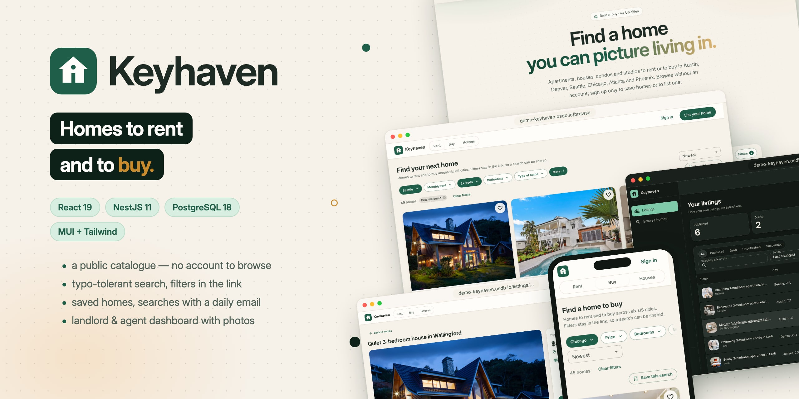

<div align="center">



# Keyhaven

**Homes to rent and to buy in six US cities.** Anyone browses; tenants save homes and searches;
landlords and agents list and manage; admins keep the site clean.


A public demo · fictional people and homes only

[Quick start](#quick-start) · [Demo accounts](#demo-accounts) · [What it does](#what-it-does) ·
[Architecture](#architecture) · [Development](#development) · [Roadmap](#roadmap)

</div>

---

## Quick start

**Docker** (everything in containers):

```bash
cp .env.example .env            # set DATABASE_PASSWORD
docker compose up --build -d
docker compose run --rm migrate npm run db:seed
```

Open **http://localhost:8080** — the landing page for a visitor, the app once signed in.

**Your own PostgreSQL 18** (Node.js 26, Docker only for the photo store):

```bash
psql -h localhost -d postgres -c "CREATE ROLE keyhaven LOGIN PASSWORD 'keyhaven';" \
  -c "CREATE DATABASE keyhaven OWNER keyhaven;" -c "CREATE DATABASE keyhaven_shadow OWNER keyhaven;" \
  -c "CREATE DATABASE keyhaven_test OWNER keyhaven;"
make setup      # photo store (RustFS), npm ci, migrations, seed
make dev        # backend :3000 · app :5180   (make landing → landing page :4321)
```

`backend/.env` holds `DATABASE_URL`. Emails (verification, reset, the daily digest) go to the
backend log unless `EMAIL_TRANSPORT=smtp`.

## Demo accounts

Password for all: **`Keyhaven-Demo-2026!`**. Browsing needs no account.

| Role | Account | Sees |
|---|---|---|
| Tenant | `maya.lopez@keyhaven.example` | Saved homes and searches, the daily email |
| Landlord | `daniel.reyes@keyhaven.example` | Their own listings |
| Agent (Harborline Realty) | `priya.nair@harborline.example` | The agency's listings |
| Admin | `alex.morgan@keyhaven.example` | Every listing; can suspend one |

Anyone can sign up as a tenant or a landlord; the verification link is in the backend log.

## What it does

- **Catalogue** — 1,000 homes for rent and 300 for sale across Austin, Denver, Seattle, Chicago,
  Atlanta and Phoenix. Filters: city, type, price, beds, baths, pets, furnished, parking, move-in
  date; sort by newest or price; everything in the URL. Text search tolerates typos (`pg_trgm`).
- **Listing page** — photos, price and price per sq ft, the price against the median of comparable
  homes ("8% below typical for a house in Wallingford"), facts, amenities, location (the street
  only after a confirmed viewing), who lists it, similar homes nearby. The catalogue remembers
  what you opened.
- **Tenants** — a heart on every home; a saved search emails new matches daily at 08:00 UTC.
- **Landlords and agents** — create and edit listings, upload and reorder up to 20 photos (straight
  to object storage), publish / unpublish, see views and saves. Agents share their agency's listings.
- **Admins** — suspend a listing.
- **Accounts** — sign-up, email verification, sign-in, password reset, sessions, a security log.
  Server-side sessions, CSRF double-submit, rate limits, deny-by-default authorisation.

Search on the full seed, measured over HTTP (`npm run bench:search`), p50 / p95:
newest 7.5 / 15.6 ms · city + price 6.4 / 7.4 ms · typo text search 10.2 / 15.8 ms ·
houses for sale by price 4.7 / 5.6 ms.

## Architecture

```
landing/   Astro static site: the page at a signed-out / and prerendered city pages (/rent/austin,
           /buy/seattle …) for search engines, built from a committed catalogue snapshot
           (npm run snapshot)
frontend/  React 19 · Vite · MUI 9 + Tailwind 4 · TanStack Query · React Router · RHF + Zod · i18next
backend/   NestJS 11 · Prisma 7 · PostgreSQL 18 · Zod 4 · pino · argon2id · Jest + supertest
```

- Modular monolith: `user`, `audit`, `email`, `auth`, `storage`, `listing`, `saved-search`;
  controller → service → repository, explicit `select` everywhere.
- Every handler is `@Public()` or `@Authorize(policy)`; the catalogue's policies are public-scoped
  (a session only adds "saved"); foreign ids answer 403 or 404 — see `backend/test/access.spec.ts`.
- `backend/openapi.json` is generated from the Zod DTOs; the frontend generates its types and
  runtime response schemas from it.
- Ports with one adapter each: `EmailSender` (log / SMTP), `ObjectStorage` (S3: RustFS locally,
  Cloudflare R2 in production). Emails and uploads happen outside database transactions.

## Development

```bash
make check                         # every pipeline step of all three packages, tests included
cd backend  && npm run start:dev   # :3000, Swagger at /docs · npm test · npm run openapi:generate
cd frontend && npm run dev         # :5180 · npm run generate:api · npm run build (bundle budget)
cd landing  && npm run dev         # :4321 · npm run build (astro check)
```

Backend env (`backend/.env.example`): `DATABASE_URL`, `SHADOW_DATABASE_URL`, `TEST_DATABASE_URL`,
`APP_URL`, `EMAIL_*`, `R2_*` (the photo store), `SESSION_*` / `COOKIE_*`, `DEMO_*`, `LOG_LEVEL`.

## Roadmap

| Milestone | Scope |
|---|---|
| M0 — Foundation ✔ | Accounts, roles, seed, dashboards by role, access tests |
| M1 — Listings and search ✔ | Filters, typo-tolerant search, saved homes and searches, photos, views and saves |
| Public catalogue ✔ | Browsing without an account, homes for sale, the landing page |
| M2 — Viewing booking | Viewing slots, booking without double booking, confirmations, reminders, calendars |

Not planned: applications, payments, property management, map search, mobile apps.
